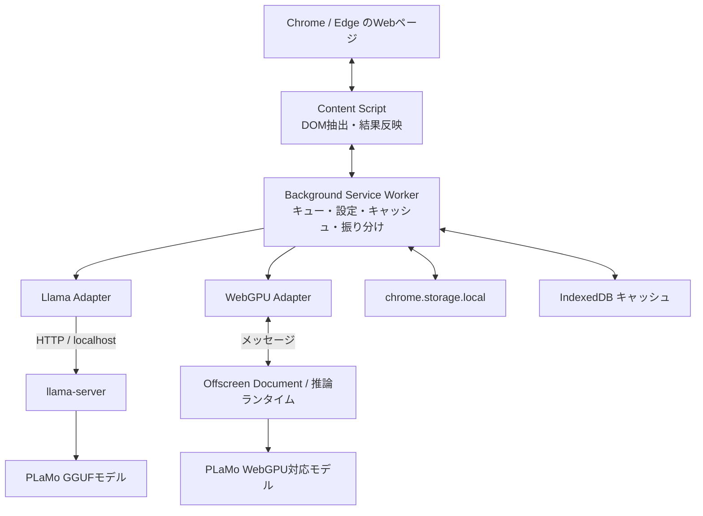

# PLaMo Web Translator — Chrome・Edge翻訳拡張機能 設計案

> WebGPUによるブラウザ内推論と、llama.cppによるローカルサーバー推論を切り替えて使う、Manifest V3対応の翻訳拡張機能の設計書です。

## 1. 目的と設計方針

PLaMo-3-Translateを使い、Chrome / Edgeで開いているWebページをローカル環境で翻訳します。外部翻訳APIへページ本文を送らない構成を基本とし、翻訳エンジンは設定画面から次の2方式を切り替えられるようにします。

- **llama.cpp方式**：PC上で`llama-server`を起動し、拡張機能からlocalhostのHTTP APIを呼び出す。
- **WebGPU方式**：拡張機能の専用実行コンテキストでブラウザ内推論を行う。

初期モデルは**PLaMo-3-Translate-0.8B**。2B、8Bは端末性能と配布形式を確認して追加します。初期の翻訳方向は「入力言語を自動判定し、日本語へ翻訳」を中心にし、翻訳先言語を設定で変更できる形にします。

**推奨開発順序：** llama.cpp方式を先に完成させ、翻訳フロー・DOM反映・設定を安定させてからWebGPU方式を追加します。PLaMo固有のモデル構造、トークナイザー、翻訳用テンプレートがWebGPUランタイムで動作するかは別途検証が必要です。GGUFをそのままブラウザへ読み込めるとは限りません。

## 2. 主な機能

### ページ翻訳

- ページ全体を翻訳し、原文と訳文を切り替える。
- 画面上で見えている部分を優先して翻訳し、スクロールに応じて続きを処理する。
- 見出し、段落、リスト、表などのテキストを対象にする。
- 訳文を元のDOM位置に反映し、ページ構造・リンク・書式をできるだけ維持する。
- 翻訳の進捗、処理中の状態、エラーを表示する。

### 選択テキスト翻訳

- 選択範囲から翻訳を起動し、ポップアップまたは小さなパネルに結果を表示する。
- 必要なら「選択箇所を置換」ではなく、原文を残したまま訳を表示する。

### 設定と管理

- 翻訳エンジンの選択：WebGPU / llama.cpp。
- モデルの選択：0.8B / 2B / 8B（対応確認済みのモデルのみ選択可能にする）。
- 翻訳先言語：日本語、英語、韓国語、中国語（簡体字）、ドイツ語、フランス語など。
- ページを開いたときの自動翻訳、選択テキスト翻訳ボタンの表示を切り替える。
- llama.cppサーバーの接続状態、WebGPUの利用可否、モデルの準備状況を表示する。
- 翻訳キャッシュの消去、原文への復元を提供する。

## 3. 画面イメージ

```text
┌──────────────────────────────┐
│ PLaMo Translator              │
│ 翻訳エンジン  [WebGPU ▾]      │
│ モデル        [0.8B ▾]        │
│ 翻訳先        [日本語 ▾]      │
│                              │
│ □ ページを開いたら自動翻訳    │
│ □ 選択テキストに翻訳ボタン    │
│                              │
│ llama.cpp: 未接続 / 接続済み  │
│ WebGPU: 利用可能 / 非対応     │
│ キャッシュを削除              │
└──────────────────────────────┘
```

## 4. 全体構成

### テキスト図

```text
┌──────────────────────────── Chrome / Edge ────────────────────────────┐
│  Webページ                                                             │
│    ↕ DOMテキスト抽出・翻訳結果反映                                    │
│  Content Script ── 翻訳要求 ── Background Service Worker              │
│                                  ├─ 設定・キュー・キャッシュ管理        │
│                                  ├─ Llama Adapter ── HTTP ──┐          │
│                                  │                           │          │
│                                  └─ WebGPU Adapter           │          │
│                                      ↕ メッセージ             │          │
│                                Offscreen Document            │          │
└──────────────────────────────────────────────────────────────┼──────────┘
                                                               │
                      llama.cpp方式：localhost HTTP API ───────┘
                      WebGPU方式：ブラウザ内ランタイム → PLaMoモデル
```

### Mermaid図



Manifest V3のService Workerは常時起動を保証されないため、WebGPUモデルの常駐場所として単独で依存しない設計にします。Offscreen Documentなどの実行コンテキストを利用する場合も、終了・再起動後に推論ランタイムを再初期化できるようにします。ブラウザや拡張機能の制約は実装前に確認します。

## 5. 技術スタック

| 領域 | 技術候補 | 用途・補足 |
|---|---|---|
| 言語 | TypeScript | 拡張機能全体の実装 |
| UI | React | ポップアップ・設定画面 |
| ビルド | Vite + CRXJS等 | Manifest V3の各エントリをビルド |
| 拡張仕様 | Chrome Manifest V3 | Chrome・Edge対応の基盤 |
| DOM抽出 | TreeWalker | 対象テキストノードの列挙 |
| 動的ページ | MutationObserver | SPAなどで後から追加される要素の検出 |
| 表示範囲 | IntersectionObserver | 表示中・表示直前のブロックを優先 |
| 設定 | `chrome.storage.local` | エンジン、モデル、言語等の保存 |
| キャッシュ | IndexedDB | 翻訳結果の再利用 |
| llama.cpp通信 | Fetch API | localhostの推論API呼び出し |
| WebGPU | WebGPU API + 対応推論ランタイム | PLaMoへの対応・モデル変換可否を要検証 |
| モデル | PLaMo-3-Translate | GGUFはllama.cpp方式で利用する想定 |

WebGPUランタイム候補としてWebLLM、ONNX Runtime Web、Transformers.jsなどを調査します。ただし、これらがPLaMoをそのまま実行できることを前提にしません。モデル形式、演算子、トークナイザー、プロンプトテンプレート、量子化形式の対応確認を先に行います。

## 6. 翻訳処理フロー

1. Content ScriptがTreeWalker等でテキストノードを調べる。
2. `script`、`style`、`noscript`、入力フォーム、非表示要素、コード領域などを除外する。
3. DOMの親子関係を保つ単位でテキストを収集し、長文をモデルの入力上限に合わせて分割する。
4. IndexedDBのキャッシュを確認し、未翻訳分だけ翻訳キューへ追加する。
5. Backgroundが設定されたエンジンへ要求を振り分ける。
6. 翻訳結果を元のノードに対応付け、ページへ反映する。
7. 元文を保存し、原文へ戻せるようにする。
8. MutationObserverで後から追加された内容を必要に応じて処理する。

HTML全体をモデルへ渡さず、DOMから抽出したテキストだけを送ります。置換前の原文を保存し、リンクや強調表示などのノード構造を不用意に壊さないようにします。翻訳キューには同時実行数の上限を設け、ページ全体を一度に大量送信しないようにします。

## 7. エンジン切り替えインターフェース例

```ts
export type TranslationRequest = {
  text: string;
  sourceLanguage?: string; // 未指定なら自動判定
  targetLanguage: string;
};

export interface TranslationEngine {
  translate(request: TranslationRequest): Promise<string>;
  isAvailable(): Promise<boolean>;
  dispose?(): Promise<void>;
}

export type EngineMode = "webgpu" | "llama.cpp";

export function createEngine(mode: EngineMode): TranslationEngine {
  switch (mode) {
    case "webgpu":
      return new WebGpuEngine();
    case "llama.cpp":
      return new LlamaCppEngine({ baseUrl: "http://127.0.0.1:8080" });
  }
}
```

実際のポート番号、APIパス、リクエスト形式は、利用するllama.cppのバージョンと起動方法に合わせて固定・文書化します。

## 8. llama.cpp呼び出し例

下記はOpenAI互換のChat Completions APIを使う場合の概念例です。実際のモデル用テンプレートと翻訳指示は、PLaMo-3-Translateの配布物・公式手順に合わせて調整します。

```ts
export class LlamaCppEngine implements TranslationEngine {
  constructor(private options: { baseUrl: string }) {}

  async isAvailable(): Promise<boolean> {
    try {
      const response = await fetch(`${this.options.baseUrl}/health`);
      return response.ok;
    } catch {
      return false;
    }
  }

  async translate(request: TranslationRequest): Promise<string> {
    const response = await fetch(
      `${this.options.baseUrl}/v1/chat/completions`,
      {
        method: "POST",
        headers: { "Content-Type": "application/json" },
        body: JSON.stringify({
          model: "plamo-3-translate",
          messages: [
            {
              role: "user",
              content: `次の文章を${request.targetLanguage}に翻訳してください。\n\n${request.text}`,
            },
          ],
          temperature: 0,
        }),
      },
    );

    if (!response.ok) {
      throw new Error(`llama-server error: ${response.status}`);
    }

    const data = await response.json();
    const translated = data.choices?.[0]?.message?.content;
    if (typeof translated !== "string") {
      throw new Error("翻訳結果を取得できませんでした");
    }
    return translated.trim();
  }
}
```

拡張機能からlocalhostへ接続する際は、Manifestのhost permissions、ブラウザ側の接続制約、サーバーのCORS設定を確認します。サーバーは原則としてループバックアドレスにのみバインドし、LANやインターネットへ不用意に公開しないようにします。

## 9. WebGPUアダプター例（骨組み）

```ts
export class WebGpuEngine implements TranslationEngine {
  async isAvailable(): Promise<boolean> {
    return typeof navigator !== "undefined" && "gpu" in navigator;
  }

  async translate(request: TranslationRequest): Promise<string> {
    // TODO: 対応ランタイムを初期化し、PLaMoモデルと翻訳テンプレートをロードする。
    // この部分はPLaMoのモデル形式・演算子・tokenizerの対応確認後に実装する。
    throw new Error("WebGPU用PLaMoランタイムは未設定です");
  }
}
```

まず最小の検証アプリで、モデルのロード、1件の翻訳、メモリ使用量、対応ブラウザを確認します。対応できない場合はモデル変換やランタイム実装が必要です。ブラウザ内モデルの初回ダウンロード容量、保存場所、破棄・再ロード時間も設計項目です。

## 10. DOM処理の考え方（例）

```ts
const SKIP_TAGS = new Set([
  "SCRIPT", "STYLE", "NOSCRIPT", "TEXTAREA", "INPUT", "SELECT", "CODE", "PRE",
]);

function collectTextNodes(root: Node = document.body): Text[] {
  const walker = document.createTreeWalker(root, NodeFilter.SHOW_TEXT, {
    acceptNode(node) {
      const value = node.textContent?.trim();
      if (!value) return NodeFilter.FILTER_REJECT;

      const parent = node.parentElement;
      if (!parent || parent.closest("[contenteditable='true']")) {
        return NodeFilter.FILTER_REJECT;
      }
      if (parent.closest("script,style,noscript,textarea,input,select,code,pre")) {
        return NodeFilter.FILTER_REJECT;
      }
      return NodeFilter.FILTER_ACCEPT;
    },
  });

  const nodes: Text[] = [];
  while (walker.nextNode()) nodes.push(walker.currentNode as Text);
  return nodes;
}
```

実用版では、ナビゲーション・広告・フッターを含めるか、短文をまとめる条件、翻訳済みマーク、属性テキスト、ページ側のDOM更新との競合を追加で設計します。原文はノードごとに保持し、同じ内容を二重翻訳しないようにします。

## 11. 実装手順

### Phase 1：llama.cpp連携の最小実装

1. TypeScript、Vite、Manifest V3の開発環境を用意する。
2. ポップアップから現在のタブへ翻訳開始メッセージを送る。
3. Content Scriptで段落単位にテキストを抽出する。
4. llama.cppサーバーの稼働確認と翻訳API呼び出しを実装する。
5. 訳文をページへ反映し、原文へ戻す操作を作る。

### Phase 2：実用的なページ翻訳

1. 除外ルール、長文分割、処理キュー、キャンセルを加える。
2. IndexedDBキャッシュと進捗表示を追加する。
3. 表示領域を優先する遅延翻訳を導入する。
4. MutationObserverで動的ページに対応する。
5. エラー時の再試行、サーバー未起動時の案内を整える。

### Phase 3：設定・操作性

1. 翻訳先言語、モデル、エンジンの設定画面を作る。
2. 自動翻訳と選択テキスト翻訳を実装する。
3. 接続状態、モデル準備状況、キャッシュ消去を表示する。
4. 設定の保存・復元と既定値を整える。

### Phase 4：WebGPU対応の技術検証

1. PLaMoモデルの形式・ライセンス・テンプレートを確認する。
2. WebGPUランタイム候補でtokenizerとモデルが扱えるか調査する。
3. 必要ならモデル変換・演算子追加の規模を見積もる。
4. Offscreen Document等でモデルをロードし、最小翻訳を実行する。
5. ブラウザ別に速度、メモリ、初回ロード、安定性を比較する。
6. 成立した方式だけをWebGPU Adapterへ組み込み、設定から切替可能にする。

### Phase 5：配布準備

1. Chrome・Edgeの権限、プライバシー説明、モデル配布条件を確認する。
2. 対応サイトや既知の制約を明記する。
3. パッケージを作成し、ストア配布または手動導入の手順を整える。

## 12. ロードマップ

| 段階 | 目標 | 成果 |
|---|---|---|
| MVP | llama.cppで選択ページを翻訳 | 手動翻訳、原文復元、基本エラー表示 |
| v0.2 | ページ翻訳を安定化 | 分割、キュー、キャッシュ、進捗表示 |
| v0.3 | 操作性を向上 | 言語・モデル設定、自動翻訳、選択翻訳 |
| v0.4 | 動的ページ対応 | 遅延翻訳、MutationObserver、キャンセル |
| 技術検証 | WebGPU実行可否を判断 | PLaMo対応ランタイム・変換方式の評価 |
| v1.0 | 2方式切替と配布 | 対応環境を明示したChrome・Edge版 |

## 13. 注意点・リスク

- **WebGPU対応は未確定**：ランタイム名だけでPLaMoが動くとは限らず、モデル構造、演算子、tokenizer、テンプレート、形式変換を確認する必要があります。
- **llama.cppのテンプレート**：PLaMo専用の翻訳形式を使う可能性があるため、汎用チャット指示だけで品質が出ると仮定しません。
- **Manifest V3の寿命**：Service Workerは停止・再起動し得るため、状態を永続化し、WebGPUランタイムの再初期化を考慮します。
- **localhost接続**：拡張機能の権限、CORS、ブラウザのローカルネットワーク保護などを確認します。サーバーの公開範囲を絞ります。
- **モデルサイズと端末性能**：0.8Bを初期値にし、2B・8Bはメモリと速度を測ってから提供します。過去のスマートフォン測定値（0.8B: 31.59 tokens/sec、2B: 10.82 tokens/sec）は、その端末・設定での参考値であり、PCやWebGPU性能の保証にはなりません。
- **翻訳品質**：小さいモデルほど短文には扱いやすくても、長文・専門用語・文脈保持で結果が変わります。実データで比較します。
- **DOMの複雑さ**：同じ文章が複数箇所にある場合、ページ更新が続く場合、React等がDOMを再描画する場合に備え、原文保持と反映競合の処理が必要です。
- **プライバシー**：外部翻訳APIを使わなくても、llama.cpp方式ではブラウザとローカルサーバー間の通信が発生します。ログやキャッシュに本文を残す扱いを明確にします。
- **ライセンス**：一般公開・再配布の前に、PLaMoモデルおよび依存ライブラリのライセンスと配布条件を確認します。

## 14. 初期リリースの推奨仕様

- 対象：Chrome・Edge、Manifest V3。
- エンジン：まずllama.cpp、WebGPUは実行可否確認後に追加。
- モデル：PLaMo-3-Translate-0.8Bを初期対象。
- 既定の翻訳先：日本語。
- 操作：手動でページ翻訳、選択テキスト翻訳、原文へ戻す。
- ページ処理：表示領域優先、段落単位、キャッシュあり。
- 接続：ローカルのllama-server。接続先と起動方法を設定・説明する。

この順序なら、ブラウザ翻訳として必要なDOM処理とUXを先に固めつつ、WebGPUの技術リスクを独立して評価できます。
